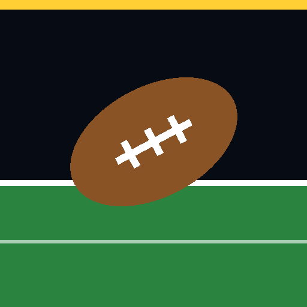

# Pocket Gridiron



**Full 11-on-11 football for your phone, played in portrait with one thumb, right in the browser.** Build a
quarterback or a wide receiver from the combine to the Hall of Fame, call plays from a 49-play book in nine
formations, and play every snap in 3D under the lights.

**Play it now:** https://eddyarriaga00.github.io/pocket-gridiron/ (no install; add it to your home screen and it
plays offline too)

**Highlights**

- **A career with a story.** The combine, draft day on a stage, contracts and trades, a rival at your position,
  press conferences after every game, a social feed that goes wild after a big day, awards night and a Hall of Fame
  induction.
- **A real playbook.** 49 plays in nine formations and 13 coverages. Every team runs its own offense (air raid, power
  run, pistol option and more), and the coach's top three calls change with the down, the distance and the score.
- **Football's rules and feel.** The play clock and delay of game, the two-minute warning, coach's challenges,
  penalties, the hard count, onside kicks, kicks you swipe, rain and snow.
- **A broadcast around it.** Two commentators, the stadium announcer, a crowd and a band, instant replays, cutscenes
  (the walkout, the coin toss, the trophy) and tracking numbers like top speed and completion probability.
- **Play it your way.** Touch, keyboard, or any game controller.
- **Built from scratch.** Plain JavaScript, three.js and GLSL shaders, with no build step. Every model, texture and
  sound is generated in code (the commentary is recorded on a local, open speech model). All teams and players are
  fictional.

## The league

32 teams, one in every city of American pro football, in two conferences (Union and Frontier) of four divisions each,
aligned the way the real league is by city. The nicknames and colors are this game's own: the Dallas Outlaws, the Green
Bay Lumberjacks, the Kansas City Blaze, the San Francisco Fog and so on. Real league and team names are trademarks, so
the game does not use them, or names made to sound like them. **Settings, Edit teams** lets you rename any team (city,
nickname, short name, colors) on your own device; it stays in your browser. A season is ten weeks: your three division
rivals twice and the four teams of another division of your conference, a different one each year. The four division
winners of each conference make an eight-team playoff: the divisional round, the conference finals, the championship.
A season saved in the old eight-team league finishes the old way and the next one starts in the full league.
Half your games are on the road (five of ten, mixed through the season; in the playoffs the better seed hosts). On
the road the field's midfield and the crowd are the other team's, you wear white, the crowd groans at your big plays,
boos your walkout, roars on your third downs (a false start comes a little easier and your hard count is drowned
out), and the stadium announcer is theirs; a road win is worth a little XP. In a league game both end zones carry the
home team's name, and on the road the booth says what kind of place it is ("the visitors walk into a hostile
building") and the analyst hears the noise on your third downs. Every city has its own weather: eleven teams play under a roof (never rain or snow), the cold cities get snow late in
the season, the wet ones more rain, the warm ones never snow; the career hub gives the next game's forecast.

## Modes

- **Career** (the main focus). Create one player, a quarterback or a wide receiver, and pick a build. At the combine you run a
  40-yard dash and position drills; your grade sets your draft pick, your signing bonus and how much the coach trusts
  you. Starters play every drive of their unit, the rotation and backups share them, and good games and practice earn
  the job. You play only your own snaps: the coach calls the plays and other drives are simulated. Stats and per-game
  goals earn XP for ratings and abilities. Each week has practice, a game grade and a headline; a season has league
  leaders, honors and playoffs with a bracket. You sign a contract at the draft, can ask for a trade while it runs,
  and choose among the eight best offers when it ends. The draft is a full first round of 32. The coach has a word
  for you after every game, and a rival at your position on the best team in your division is the man to beat (you
  play him twice a season). There are 14 trophies. Three games a season are primetime (at night, the whole league
  watching, XP +25%; the conference final and the championship always are); a big win can make you your conference's
  Player of the Week (+400 XP and a post from the league); every stat keeps your single-game career high, and the
  broadcast says so the moment you pass one. Edit team names from the hub or the new-career screen too. A receiver is
  also the kick returner (a switch on the hub): on their kickoffs and punts you are back deep, field it, and run it
  back yourself (or tap Fair catch on a punt). Returns go on your game line and earn XP; fumble one and the coach sends
  somebody else back for the rest of that game.
- **Season.** Take one team through the ten-week season and the eight-team playoff, calling and playing every snap. Your roster
  keeps its names, numbers and ratings all season, with a stat line for every player and team leaders.
- **Exhibition.** One game between any two teams. You pick the difficulty, quarter length, kickoff time and weather.
- **Milestones.** Twelve things worth doing once (a shutout, a win in the rain, a title), earned in any mode.
- **Training camp.** Three short guided drills (passing, running, tackling), five plays each. A coaching card before
  every snap says what to try, and each drill is scored with one to three stars. The game offers it the first time
  you open it.

## On the field

- Pass plays, run plays, run-pass options, play action, screens, bootlegs, trick plays (a jet sweep, an end around for
  your receiver), field goals, punts, live kickoffs, kneel and spike. 49 offensive plays from nine formations (Singleback,
  Shotgun, I-Form, Gun Trips, Gun Empty, Pistol, Gun Bunch, Jumbo, Gun Slot) and thirteen defensive calls, several of
  which show their own look before the snap (a safety rolled down, a blitzer walked up). A tag under the field names the
  kind of play on every snap. Before the snap you can tap a receiver's letter to change his route, call an audible (the
  other plays from the same formation), flip the play, or try a hard count (a fake snap count that now and then draws
  the defense offside, and once in a while makes your own lineman flinch); on defense you can change the coverage.
- The play-call sheet shows three plays at a time. On the Coach tab the first three are the coach's picks for this down,
  distance and score, shared out between the kinds of play by how likely each is (third and one: two runs and a pass),
  then everything else he would call, in order; swipe, scroll or page with the arrows for more. The Run, RPO, Short,
  Deep and Special tabs hold every play of one kind, best first. A career quarterback gets the same sheet, the coach's
  call first.
- Tracking numbers on the broadcast: a long run or catch shows the ball carrier's top speed in miles an hour (held
  over a third of a second, the way tracking chips report it: the fastest come out near 21), an improbable catch its
  completion probability, and third downs how often the offense has made them today. A spot inches from the line to
  gain goes to a measurement. At the quarter breaks of a season or career game, the scores around the league so far,
  your division's games first (those games were played out at kickoff, so the standings later match).
- Every team has its own offense, named on the matchup card before kickoff: air raid, power run, pistol option, west
  coast, spread, vertical, run and shoot, pro style. Each favours its own formations, play action or trick plays, and
  every play caller (the computer's, your coach's in a career, the "Suggested" card) remembers what it has called:
  the last call is all but ruled out, the last few are unlikely, and a play gets less likely each time it is used. The
  computer runs half its plays to the other side. In a two-game test career the coach called 29 different plays in 33
  snaps (it was 18 in 42), never the same play twice in a row.
- Hold a receiver's letter to build throw power on a green bar, then let go: a lob, a touch pass or a bullet.
- Catches look like catches: a receiver with a defender on him goes up for the ball, arms high, and takes it at the top
  of the jump (the defender goes up with him), and a ball thrown off his line gets a stretch, chest out and arms long.
- Kick with a swipe: field goals, extra points, punts and your kickoffs, in a career too (your team's kicks are yours to
  make whatever your position). The swipe's angle is the aim and its length and speed the power: a straight, strong
  swipe splits the uprights, a soft kickoff stays in play. The timing bar still works. The extra point is a real kick
  from the 15, not a roll of the dice.
- With the ball: Sprint, Juke, Spin, Power (truck a tackler in front of you, stiff-arm one beside you) and Hurdle.
- On defense: Switch, Dive, Hit (a hit stick that can jar the ball loose) and Strip.
- Punt returns you play, with fair catches and muffs. Fumbles you can dive on, or scoop up and run back, interceptions, sacks, safeties, overtime, timeouts, two-point tries, onside kicks, and
  four kinds of flag (false start, offside, holding, pass interference) that Settings can switch off. Rain and snow make the ball harder to catch and hold.
- Instant replays of big plays, at half speed from the sideline and then again from the reverse angle (a camera ahead
  of the play looking back at the ball carrier), a flyover before kickoff, three officials who signal, a player of the game.
- A broadcast booth: a play-by-play man and an analyst call the game ("Third and six." ... "He goes deep!" ...
  "Touchdown, Outlaws!" ... "You can't draw it up any better than that."), and sum up scoring drives ("Twelve plays on
  the drive."). The referee announces penalties over the stadium speakers ("Holding, offense. Ten yard penalty.
  Repeat third down."), the stadium announcer welcomes everybody before the opening kick and leads the crowd's
  "FIRST DOWN!", and the calls know who has the ball ("The quarterback keeps it himself!"). 365 recorded lines, every one
  written for this game and spoken by an open speech model; the big calls cut in over the small talk, and the crowd
  sits under them. Settings can turn the commentary off; the referee and the announcer are part of the stadium.
- The two-minute drill: late in a half an offense that needs points goes no-huddle, with less time off the clock
  between plays and the play-call sheet back sooner, marked "No huddle".
- The two-minute warning in the second and fourth quarters (quarters of three minutes or more): the clock stops at
  2:00 and the referee calls it. The referee also announces the coin toss and every timeout ("Timeout, Outlaws.
  That's their second timeout.").
- A 35-second play clock when you have the ball: it shows next to the down from :35 and turns red at :05; let it run
  out and it is a five-yard delay of game, called by the referee.
- Coach's challenge: a spot within half a yard of the line to gain is sometimes given the wrong side of it. Whoever
  the ruling went against may challenge (two a game; a challenge that fails costs a timeout): "Challenge the spot" on
  the next play-call screen. The other coach challenges the bad ones, and so does your coach in a career. The
  referee announces it and the result ("After review, the ruling on the field is reversed.").
- The teams switch ends after the first and third quarters: a crane shot rises over midfield, and the end zones and
  the sun are on the other side when it comes down.
- A career ages: you come into the league at 22, grow a little each of your first seasons, hold in your prime, and
  from 30 lose speed and elusiveness first and skill later. Your rival talks before you play his team, and after.
- The media around a career. After every game you go to the podium: three questions from reporters, picked from how
  the game went (your stat line, a loss, your rival, a promotion or a demotion, the next opponent, last week's
  callout). Each answer has a tone (humble, team first, owning it, confident, trash talk, a guarantee, pointing
  fingers, deflecting) and does something: humble and team-first answers build the coach's trust, confidence and
  trash talk build hype and followers but cost trust unless you played like it, and blaming teammates costs the most.
  You can also walk out. The coach tells you what he thought of your answers. Call out the next opponent and it
  follows you into that game: back it up for +250 XP (+400 for a guarantee), lose and it costs trust, hype and
  followers, and the opposing fans post your quote back at you.
- Then the internet reacts: fans of both teams, analysts, reporters, teammates, your rival, and your coach quoted from
  his own press conference. A quiet game draws a handful of posts; a monster game floods the feed, trends, sends a fan's
  post viral and fills the replies. Followers and hype grow with big games and big words. The Social tab in the career
  hub keeps your mentions, your quotes, the follower count, the hype meter and your record of callouts backed up or
  eaten. Your teammates who post are the same players all career, and nobody in a feed says the same thing twice in a
  week. Every person, handle and outlet is invented.
- The Social tab is laid out like a profile: your name and handle, followers, hype, callouts backed up and eaten,
  partners; anything waiting on you (a callout, an offer); then Mentions (this week open, earlier weeks folded), On the
  record (your quotes) and Partners.
- League leaders by category: for quarterbacks passing yards, passing touchdowns, passer rating (the official
  formula), completion percentage and rushing yards; for receivers receiving yards, receptions, touchdowns, yards per
  catch and targets; and around the league rushing yards, sacks (in halves), interceptions and tackles. Rate stats
  need volume to qualify, the way a real leaderboard does.
- Broadcast graphics: a player card across the top after a touchdown or a big play (number, name, team, his line in
  this game; yours, in a career), and both teams' numbers when they change ends after the first and third quarters.
- Cutscenes (Settings turns them off; a tap skips any of them). A career game opens in the tunnel: an inflatable
  tunnel in team colors at the back of the end zone, smoke and two jets of flame, the starting offense running out
  behind you, the announcer's welcome and the crowd going up, the camera from inside the mouth out to the field.
  A rival game then cuts to midfield: you and your rival face to face, his trash talk (and your callout, if you made
  one) on the caption; he points at you, you answer with a fist to your chest.
  Winning the title puts you on a stage at midfield with a silver cup over your head, your teammates round the stage,
  confetti and fireworks, before the results.
  Every game (exhibition, season and career) opens with the coin toss at midfield: three captains a side and the
  referee, the coin up in the air and down on the turf, his arm out to the winners, the announcer's call. In a career
  you are one of the captains once you are the starter.
  Draft day is on a stage at midfield under a draft board in your new team's colors: you walk up, shake the
  commissioner's hand and hold up your new jersey with your name and number while the announcer reads the pick.
  After every career game the press conference opens on you at the podium, in a team hoodie and cap, behind a
  cluster of microphones in front of the team's backdrop, cameras flashing.
  Retiring into the hall plays the induction: a stage under a "Hall of Fame · Class n" board, your bust on a pedestal
  under a cloth in team colors, a drum roll, the cloth lifted off, the plaque with your name, team and class, and you
  waving to the applause beside it, before the hall itself.
- Media day, the week of a rival game: one question about him from the hub, answered like the podium's, and a callout
  made there is settled in that game. The booth knows about your callout: it opens the game talking about it, cheers
  when your side scores to back it up, calls it shaky when you trail late, and settles it at the final whistle.
- Endorsements: two games in a row with hype at 55 or more bring an offer from a brand (invented: cleats, sports
  drinks, trucks, chips, phones, gyms, watches, insurance). Sign it for XP now and XP every game, the pay set by your
  following; two deals at most; a brand walks away when your hype falls under 25.
- Career awards night after every season: MVP, Offensive Player of the Year, Rookie of the Year, All-League at your
  position and your position's statistical title, each with its nominees from around the league. It is a ceremony:
  the stadium announcer introduces each award from the stat title up to the MVP, a drum roll, then the winner comes up
  to applause (louder, with a fanfare, when it is you); Reveal all skips it. Retire a career
  and it goes to a hall of fame vote; every retired career is kept in the Hall of fame, on the main menu.
- After every scoring drive, its plays, yards and time. Halftime and the final screen (in every mode) show the
  scoring summary, each score with the drive that made it, and each team's passing, rushing and receiving leaders.
- Every voice is recorded, none synthesized: the booth, the referee, the stadium announcer (the draft included), and
  the players on the field: the quarterback's cadence and "Hut!", the defense calling out the formation, whoops,
  "Ball! Ball!" on a fumble.
- A stadium you can hear, the rest of it made in code: pads that crack harder the faster the hit,
  the defense calling out the formation before the quarterback starts and whooping after a sack or a takeaway, a field
  goal that clangs off the upright (in, or out), the ball thudding on the turf,
  a crowd that chants, boos a flag on the home team and builds a wall of noise on third down, the referee's call
  echoing over the speakers, the crowd finishing the announcer's "first down", a band in the stands and a halftime show.
- Players run on feet that stay where they land: the legs are solved each frame so a planted foot neither slides nor
  sinks, forward, backward or in a sideways shuffle, and linemen crouch with their soles flat on the turf. A defender
  with ground to cover turns and runs, looking back at the quarterback. The quarterback winds up as the power bar fills.
- About a third of the reserves on each bench pace the sideline between plays, a yard or two from their place and
  back, and stop to watch or celebrate.
- A tackle is two men, not one after the other: the tackler bends to the hit with his shoulder at the runner's hip and
  his arms round him, and they go down together. Defenders who are on top of the play dive on and pile up on the two
  of them, and the pile comes apart from the top. Anyone else close by steps clear instead of standing in it.
- Eleven touchdown celebrations: the scorer jumps, spikes it, struts, takes a knee, roars, bows, shuffles, salutes,
  points both arms to the sky, flexes or leaps; his teammates jump, pump a fist, clap, wave to the crowd or shuffle,
  and about one in three the whole side does it together on the same beat. Teammates within 40 yards run to the
  scorer, gather round him an arm's length apart and celebrate facing him. In a career you can pick your own (the
  hub, under Touchdown celebration). On the other side heads go down and hands go to helmets.
- The officials signal touchdowns, first downs, incomplete passes, timeouts and the two-minute warning.
- Everybody watches something. Helmets turn to the ball in the air, to the man carrying it, to the quarterback; a
  receiver looks back for the ball once he is into his route, a ball carrier turns his helmet to the defender closing
  on him, a quarterback in the pocket goes through his receivers,
  and the reserves on the bench follow the play up and down the field.
- A block is two men with their hands on each other: the blocker's inside on the chest plate, the defender's on the
  shoulder pads, elbows bent, helmets side by side.
- Every control has a touch area of at least 44 by 44 pixels, however small it is drawn, and the layout is checked from
  320-pixel phones up to a desktop window. A phone held sideways is asked to turn upright.

## Controls

| | Touch | Keyboard | Controller |
|---|---|---|---|
| Move | Drag anywhere on the field | Arrows / WASD | Left stick or d-pad |
| Snap, ready, kick | The large button | Space | A |
| Pass (as quarterback) | Hold a lettered receiver or its button: a green bar fills with power. Let go to throw (a quick tap is a lob, a full bar a bullet) | 1–5 | Each receiver wears a button's letter: A, B, X, Y or RB (hold, let go) |
| Call for the ball (career receiver) | Call | C | A |
| Sprint | Hold Sprint | Space | RT (R2) |
| Juke / Spin / Power / Hurdle | The buttons | J / K / L / H | B / X / A / Y |
| Switch / Dive / Hit / Strip (defense) | The buttons | Q / E / F / R | B / A / X / Y |
| Audible / Flip / Hard count (before the snap) | The buttons | V / X / G | LB / RB / Y |
| Time out | Time out, right after the whistle or on the play-call sheet | T | View (Select) |
| Fair catch | Fair catch, while a punt to you is in the air | Space | A |
| Pause | The pause button under the scoreboard | P or Esc | Start |
| Zoom the camera | − and + under the scoreboard | − and =, or the mouse wheel | Right stick |
| Menus and the play-call sheet | Tap | Tab, Enter | D-pad moves a ring, A picks, B back, LB / RB tabs, LT / RT a page of plays |

Any controller the browser reports works (Xbox, PlayStation, Switch Pro and most others); it takes over from its first
press, so one left plugged in changes nothing until you use it.

Settings has the accent color, 2D or 3D graphics, sharpness, camera zoom, shadows, the glow pass, close-up model detail,
replays, penalties, the button side, volume, sound, music, the commentary, vibration and the control tips.

## How it is built

```
index.html              page shell (GitHub Pages serves this from the main branch)
css/game.css            all styles
js/data.js              teams, formations, routes, both playbooks and each team's offense
js/game.js              the engine: plays, AI, rules, controls, menus, the 2D overlay and 2D fallback renderer
js/shaders.js           GLSL: turf, sky dome, crowd, rim light on players, glow and vignette pass
js/render3d.js          three.js renderer: stadium, instanced player models (a far and a near level of detail),
                        shadows, weather, cameras
js/audio.js             the sound engine: synthesized effects, a crowd built from rendered voices, a voice on the
                        stadium speakers, a marching band, music, weather, and the booth that plays the recorded
                        commentators (the device's speech voice is only their stand-in when the clips cannot be had)
js/vo.js                the index of the commentators' clips (written by tools/voice.py)
audio/vo.pack           the clips themselves, end to end in one file (about 3 MB of AAC)
js/league.js            schedule, standings and playoffs shared by Career and Season
js/career.js            Career mode
js/media.js             The press conference and the social feed around a career (career.js draws the screens)
js/season.js            Season mode
js/camp.js              Training camp: drill scripts, scoring and screens
js/milestones.js        Milestones earned across all modes
docs/ROADMAP.md         what is done, what is next, and a log of how each part was checked
tools/                  local server, test harness, interface audit, formatter, bundler, icon generator, and the
                        booth: commentary.json (the script) and voice.py (records it)
```

Nothing is downloaded at run time except three.js 0.159.0 from cdnjs, the Archivo font from Google Fonts and the
commentators' clips (after the first tap, and only while the commentary is switched on). There are no image or model
files: the field, the crowd, the players and every sound but the two commentators are generated in code.
Without WebGL the game falls back to its 2D canvas renderer.

### The broadcast booth

The commentators are not real people and do not imitate any: no real announcer's voice, name or catchphrase is used,
and every line in `tools/commentary.json` was written for this game. The lines are spoken by
[Kokoro-82M](https://huggingface.co/hexgrad/Kokoro-82M), an open speech model (Apache 2.0), run on a Mac through
[kokoro-onnx](https://github.com/thewh1teagle/kokoro-onnx) (MIT). `tools/voice.py` records each line, masters it
(trim, a lift in pitch, pace and brightness for the worked-up calls, a compressor, a set loudness), checks it against
its words by counting syllables, encodes it as AAC with macOS's `afconvert`, and writes `audio/vo.pack` and `js/vo.js`.
Neither the model nor its Python environment is in the repository; they live in `.voice/`, which git ignores. To
record again after changing the script or a voice:

```
python3.12 -m venv .voice/venv && .voice/venv/bin/pip install kokoro-onnx==0.6.1
# put kokoro-v1.0.onnx and voices-v1.0.bin (the kokoro-onnx release "model-files-v1.0") in .voice/model/
.voice/venv/bin/python -I tools/voice.py          # records only the lines that changed, then rebuilds the pack
.voice/venv/bin/python -I tools/voice.py --reel   # also writes .voice/booth-sample.m4a, a minute of both voices
```

A voice is a line in the script: a mix of the model's voices, a speed, and two tone settings. Changing it and running
the tool gives the whole booth a new voice in about five minutes.

## Run locally

```
python3 tools/serve.py 8000
```

Then open http://localhost:8000. The server sends no-cache headers, so edits show up on reload.

## Testing

Load the harness in the browser console:

```js
await fetch('tools/harness.js?' + Date.now()).then(r => r.text()).then(t => (0, eval)(t))
```

- `H.sim(12, 180)` plays computer against computer and reports yards per carry, completion rate and so on.
- `H.exh(2, 120)`, `H.career('QB', 2)`, `H.careerSeasons('WR', 2)` play scripted games in each mode (careers are QB or WR).
- `H.camp('run', 4)` plays a training-camp drill (`'pass'`, `'run'` or `'tackle'`) with a simple test player.
- `H.fingerprint()` is a seeded run. After a change that should not alter behaviour it must return the same string.
- `PG.dbg.lab('Smash', 40)` runs one play 40 times from first and ten (clear weather, every other snap mirrored) and
  returns each snap's yards, the throw's target and how it ended. Seed it the same way for every play
  (`PG.dbg.seed(3)` before each) so the plays are compared with the same players.
- `PG.dbg.seed(n)` makes any run repeatable.
- `PG.audio.booth` shows the commentators: whether their clips loaded, what is being said, what is waiting, and
  `log`, every line the game has asked for (it fills with the sound off too, so a scripted game shows what they would
  say). `PG.audio.call('td', { pri: 2 })` asks for a line by hand.
- `PG.audio.deaf(true)` keeps the whole mix running but sends nothing to the speakers, so sound can be tested, and
  metered, in silence.
- `await PG.audio.report()` renders every sound off line and gives its peak, loudness and spectrum
  (`PG.audio.measure('vo:td')` does one commentary line through the whole mix);
  `PG.audio.meter` reads the level of what is playing now, and `PG.audio.asked` lists what the game has asked the
  stadium for (a referee's call, a boo, the halftime show), so the hooks can be checked without sound.

`PG.r3d.gait(8)` runs a figure at eight yards a second and measures its feet (how far a planted foot slides, how deep
it sinks, how long it is down); `{ how: 'side' }` makes it a shuffle, `{ who: 'ref' }` an official.
`PG.r3d.strip(8)` returns a picture of one stride from the side (`{ view: 'front' }` from in front).
`PG.r3d.tackle(0)` stages a tackle (the angle it comes from, in radians) and measures it: how far the tackler's hands
are from the runner, whether either body is inside the other or under the turf. `PG.r3d.tackleStrip(0)` draws it.
`PG.r3d.eyes()` puts the ball carrier at a set of angles round a running defender and says how far off his helmet
points (`PG.r3d.eyesStrip()` draws it). `PG.r3d.block(0.8)` locks a guard and a tackle up at the engine's distance and
measures where their hands, chests and helmets are (`PG.r3d.blockStrip()` draws it from four sides).
`PG.r3d.celebStrip()` draws every touchdown celebration. `PG.r3d.besideSweep()` stages 156 tackles with another man beside them and reports how far he is left standing in the
two on the ground. None of these draws a real play, so after any change to the renderer also play a whole game with
`PG.dbg.render()` after every step and watch for errors: the harness alone never draws.

`tools/audit.js` is the interface audit. Load it the same way after the harness, then run
`await A.menus(); A.play('exh'); A.play('career'); A.play('camp'); A.report()` at a phone size such as 320 by 568.
It walks every screen and a scripted game and lists touch areas under 44 pixels, overlapping controls, clipped or cut
text, type under 10 pixels, contrast under 4.5 to 1 (measured against the picture really behind the text) and blocks
of the in-game display that overlap. An empty report is the standard.

`node tools/fmt.js <files>` is the house formatter. `node --expose-internals tools/astcheck.js before.js after.js`
proves a reformat did not change the program.

`python3 tools/bundle.py` writes `pocket-gridiron.html`, the whole game in one file.
